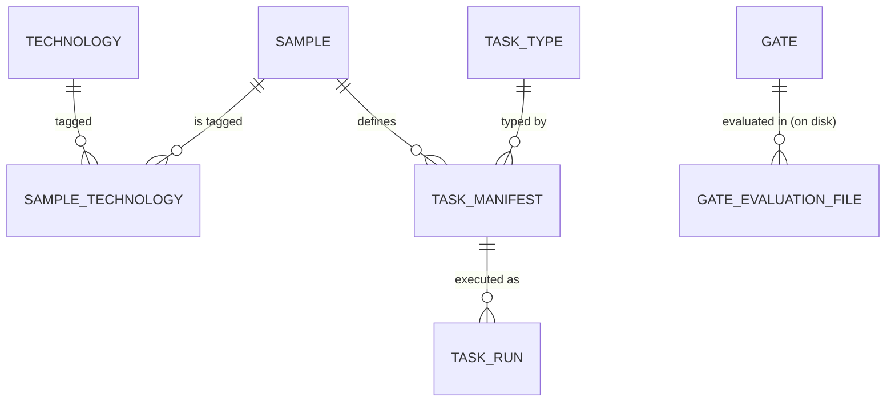

# SPEC — `er.md` (data model)

The registry is a **single SQLite database** (`bench.db`, git-tracked).
It holds **inputs only** — what was run, on which sample, with which
manifest. **Results are files** under `out/runs/<run_id>/` (see
`behavior.md`), never DB rows. That keeps `bench.db` small, diffable and
free of binary churn.

## Diagram



`GATE` deliberately has **no FK to `TASK` or `TASK_MANIFEST`**: gates
simply exist (v1 ships three, more will be added), they are not ordered,
and they are not owned by a task. Any run can be evaluated by any gate.

## Tables

### `TECHNOLOGY`

| column | type | notes |
|---|---|---|
| `technology_id` | INTEGER PK | surrogate |
| `name` | TEXT NOT NULL UNIQUE | `java7`, `jsp`, `mysql`, `spring-mvc`, `vraptor`, `shiro`, `postgres`… |
| `kind` | TEXT NOT NULL | `language` \| `runtime` \| `framework` \| `database` \| `server` \| `other` |

A technology is a *vendor-independent capability tag*. It is what the
adapter registry resolves against.

### `SAMPLE`

| column | type | notes |
|---|---|---|
| `sample_id` | INTEGER PK | surrogate |
| `slug` | TEXT NOT NULL UNIQUE | bench-side identifier, used by `cases/<slug>/` — `mamute`, `online-study-system`, `openclinica` |
| `project_id` | TEXT NOT NULL | upstream identifier (`owner/repo`) |
| `branch` | TEXT NOT NULL | branch the pinned commit lives on |
| `commit_sha` | TEXT NOT NULL | **the** pinned commit — the environment *and* `compose.yaml` must exist in it |
| `license` | TEXT NULL | |
| `description` | TEXT NULL | |
| `entrypoint` | TEXT NULL | path **inside the sample** to its compose file (normally `compose.yaml`); NULL = sample not runnable yet |
| `target_url` | TEXT NULL | host URL the app is reachable on once started, e.g. `http://localhost:8090` (empty for dynamic allocation) |

`UNIQUE(project_id, branch, commit_sha)` — the natural key; `sample_id`
surrogate keeps every FK one column wide.

### `SAMPLE_TECHNOLOGY`

M:N mapping. `PK(sample_id, technology_id)`.
`mamute` → `java7`, `jsp`, `mysql`, `vraptor`. Adapter selection reads
this set (a technology set can satisfy several capabilities, and one
adapter serves many samples).

### `TASK_TYPE`

| column | type | notes |
|---|---|---|
| `task_type_id` | INTEGER PK | surrogate |
| `name` | TEXT NOT NULL UNIQUE | `decouple_slice`, `oneshot_decoupling` |
| `description` | TEXT | |

### `TASK_MANIFEST`

The manifest **is the map** for one (sample, task type, version): the
prompt the agent receives, which adapters to use for which capability,
and which behaviour cases verify it.

| column | type | notes |
|---|---|---|
| `manifest_id` | INTEGER PK | surrogate |
| `sample_id` | INTEGER NOT NULL FK→`SAMPLE` | |
| `task_type_id` | INTEGER NOT NULL FK→`TASK_TYPE` | |
| `version` | INTEGER NOT NULL | bump on any prompt/scope/adapter change |
| `prompt` | TEXT NOT NULL | handed to the agent verbatim |
| `bindings_json` | TEXT NOT NULL | capability → adapter, with options (below) |
| `scope_json` | TEXT NOT NULL | cases + routes (below) |

`UNIQUE(sample_id, task_type_id, version)`.

`bindings_json` — adapters are chosen **by technology**, not by sample;
the manifest pins the *exact* adapter + version so results stay
comparable across runs:

```json
{
  "stack":   {"adapter": "compose@1"},
  "browser": {"adapter": "playwright@1"},
  "db":      {"adapter": "mysql@1",
              "options": {"service": "db", "user": "root", "password": "",
                          "database": "mamute_development"}}
}
```

`scope_json`:

```json
{
  "cases": ["vote-flow__upvote-increments-count",
            "vote-flow__downvote-decrements-count"],
  "routes": ["/login", "/question/{id}/voto/positivo"]
}
```

### `TASK_RUN`

| column | type | notes |
|---|---|---|
| `run_id` | TEXT PK | `uuid4().hex` — the filesystem key too |
| `manifest_id` | INTEGER NOT NULL FK→`TASK_MANIFEST` | |
| `started_at` | TEXT NOT NULL | ISO-8601 UTC |
| `finished_at` | TEXT NULL | NULL while running |
| `harness` | TEXT NOT NULL | `pristine`, `claude-code`, `codex`, … free text, the agentic system that produced the diff |
| `environment` | TEXT NULL | free-text description of the machine/image |
| `estimated_cost_usd` | REAL NULL | |
| `run_duration_s` | REAL NULL | |

The pinned commit is **not** duplicated: it is
`TASK_RUN → TASK_MANIFEST → SAMPLE.commit_sha`, and the runner asserts
the checkout matches it before starting (`behavior.md` §2).

### `GATE`

| column | type | notes |
|---|---|---|
| `gate_id` | TEXT NOT NULL | `functional_parity`, `network_isolation`, `trace_similarity` |
| `version` | INTEGER NOT NULL | |
| `description` | TEXT NOT NULL | |
| `threshold` | REAL NOT NULL | non-negative |
| `direction` | TEXT NOT NULL | `minimize` \| `maximize` |

`PK(gate_id, version)`. Gate **results** are not stored here — each
evaluation writes `out/runs/<run_id>/gates/<gate_id>.json`, which records
the `value`, the `verdict`, *and* the threshold/direction that were
applied, so an old result stays self-describing after the gate definition
is bumped.

## Invariants

1. Every FK is a single-column surrogate; natural keys are `UNIQUE`.
2. No results, no timings-of-gates, no scores in the DB.
3. `GATE` has no dependency on task or manifest.
4. `SAMPLE.commit_sha` must contain whatever `SAMPLE.entrypoint` points at.
5. Deleting a row never cascades into history: `TASK_RUN` uses
   `ON DELETE RESTRICT`.
